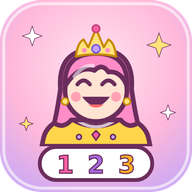

# Princess Berhitung

Aplikasi web belajar berhitung bertema putri untuk anak **TK** dan **SD kelas 1–3**. Anak menjelajah Kerajaan Angka bersama **Putri Kiki**.

## Fitur

- **Peta istana:** delapan level per istana, ditutup Peti Permata di level terakhir.
- **TK:** Istana Angka, Pola, Tambah, Bentuk, Kurang, dan Menulis (menebalkan angka dengan jari).
- **SD kelas 1–3:** penjumlahan, pengurangan, perkalian, pembagian, nilai tempat, jam, uang, dan mengukur.
- **Ruang Belajar:** penjelasan langkah demi langkah dengan gambar.
- **Tantangan:** Balap Unicorn melawan waktu dan Misi Minggu Ini.
- **Koleksi:** album 60 stiker (bisa diketuk untuk dilihat besar), Lemari Putri (gaun, warna rambut, kacamata, tiara), dan sertifikat.
- Suara, musik kotak musik, dan soal yang dibacakan.

## Menjalankan

Cukup buka `index.html` di browser. Semuanya ada dalam satu file, tanpa proses build.

Untuk dipasang di layar utama HP, unggah ke hosting statis (misalnya GitHub Pages). Lalu buka di browser HP dan pilih **Tambahkan ke Layar Utama**.

Progres anak disimpan di browser perangkat itu (localStorage).
